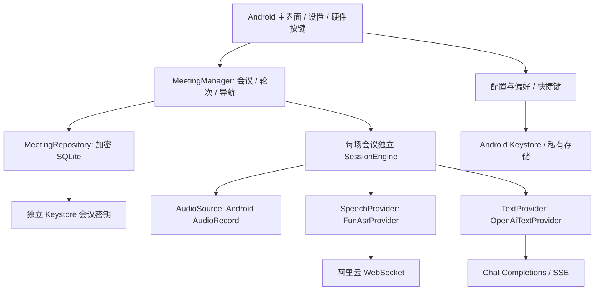

# 架构与接口约定

## 系统主题与动态配色

详见 [THEMING.md](THEMING.md)。`AppTheme` 解析 Material 3 颜色角色；支持时应用 DynamicColors，其余设备由 values / values-night 提供备用配色。保留原生 Activity/View，新增 Material Components 1.13.0 及其 AndroidX 传递依赖。

视图分别绑定背景样式回调与文字颜色角色，Markdown 颜色 span 携带语义角色。Activity 原地处理 uiMode，弱引用窗口清单覆盖已打开的抽屉和对话框；只更新样式，不进入会话、采集或分析调度。前台恢复时重新读取调色板；其他配置重建保留 Application 业务状态，模型表单草稿只经非配置实例内存传递，不写 Bundle 或偏好。UiLocale 只覆盖 locale，避免固定 uiMode。

下文早期实现中的固定黑色或品牌色描述，现由上述主题角色替代；窗口、页面、电平轨道继续使用相同背景角色。

## 模块

- `core`：纯 Java；状态机、段落合并、偏好与快捷键、提示词构建、配置校验、网络适配器。电脑直接运行单元 / MockWebServer 集成测试。
- `app`：Android Views、自适应布局、录音权限与 AudioRecord、Keystore、系统生命周期与 KeyEvent。
- `scripts`：本机构建与可选的少量模型连通测试；真实密钥通过终端隐藏输入 / 环境变量提供，不进入项目。

UI 不直接发模型请求。Application 持有会话对象，Activity 只订阅快照；旋转重建不会重建会话。同步状态机将网络 / 麦克风回调串行处理，独立调度器管理超时。任务有轮次 token，取消后迟到回调被丢弃。UI 更新回主线程并合并为约 32ms 一次，避免逐 token 重排积压。

主界面根视图在触摸模式下保留焦点，避免首个导航键被用来建立焦点。Android 13 以上仅在设置页注册平台 `OnBackInvokedCallback`，主界面返回由系统处理；低版本保留旧返回路径。参见 [Android 返回手势适配文档](https://developer.android.com/guide/navigation/custom-back/predictive-back-gesture)。

当前状态通过 `meeting_status` 显示在答案面板的滚动区外，单独由快照和前台秒表刷新；顶部只保留偏好名称。状态视图不属于自动隐藏的工具栏，切换原文布局时重建并立即恢复当前状态。答案面板直接使用页面背景色。

主界面移除更多菜单；`copy_answer` 是状态行右侧的复制图标，`copy_transcript` 位于原文面板标题行右侧，均在滚动视图之外，使用当前会议完整内容。两者与正文面板同生命周期，原文隐藏时其复制按钮也不可交互。会议抽屉无标题 / 返回按钮；仅当前选中项创建三点操作视图，整行共享圆角背景并裁切子项点击反馈，选择和操作仍为独立无障碍触摸目标。

Auto / 常亮状态提示使用 `Toast.LENGTH_SHORT`，与删除等操作共用系统 Toast 外观。新提示取消旧实例；换页、退出前台或销毁 Activity 时清理。移除 PopupWindow 及其锚点、尺寸计算和延迟定位逻辑。

`UiLocale` 在 Activity 绑定上下文时将系统首选语言归一为 zh-Hans / en。Android 13 及以上读取 LocaleManager 系统语言，旧版读取系统 Resources；不依赖可能已由应用资源匹配重排的 Activity locale 列表。所有界面文字位于默认英文 `values/strings.xml` 和简体中文 `values-b+zh+Hans/strings.xml`；两种语言始终随包分发，关闭 App Bundle 语言拆分。`LocalizedMessages` 仅在呈现状态 / 错误时将 core 及旧存档的固定消息映射为资源，参数化错误保留安全的服务名 / HTTP 码，不对用户内容作全局替换。业务状态与错误分类仍由 core 管理。

`SavedState.transcript` 与会议原文聚合器允许传入展示标记；新归档保留结构化段落，以便本地化未定稿标记而不替换正文中的同名文字。旧归档缺少段落时保留原始文本。默认会议名根据摘要中的创建时间和默认名称标记在 UI 生成，不重写人工命名或自动摘取的题目。详细策略和扩展步骤见 [LOCALIZATION.md](LOCALIZATION.md)。

顶部工具栏与底部操作区的显隐统一由 Activity 管理，不改变 SessionEngine 或网络请求。进入主界面即安排延迟收起，状态变化可显示反馈，逐字听写 / 答案更新不会重置计时。触摸事件先交给原控件，轻点结束后再临时展开；拖动、长按和选字分别处理。上下两区使用同一动画进度，布局分类始终按完整展开高度计算，避免可用高度变化导致面板反复重建。显隐模式保存进 Activity 状态；离开前台清理计时与动画。硬件快捷键直接处理会话 / 滚动，不依赖按钮是否可见。

## 统一语音边界

实时能力：`start(listener)`、`sendAudio(pcm)`、`finish()`、`cancel()`。事件：`ready`、`segment(id,text,isFinal,startMs,endMs)`、`completed`、`failed`。PCM 为 16kHz、单声道、signed 16-bit little endian。按约 100ms 发送，队列超限报错，避免网络拥塞时无限堆积。

段落按稳定 ID 排序；中间修订替换对应段，定稿后忽略迟到的中间结果。`completed` 才表明整个任务结束。心跳包不进入原文。服务端异常不把临时文字当定稿。

录音能力后续使用 `transcribe(fileRef)` 和任务状态边界，输出复用同一种段落结果；能力列表显式声明是否支持实时 / 文件。初版只实现实时，不提供不可用的文件模式按钮。

## 阿里云 Fun-ASR 适配器

1. TLS WebSocket 使用 Bearer API Key。
2. 发送 `run-task`：UUID `task_id`、`streaming:duplex`、`task_group:audio`、`task:asr`、`function:recognition`、模型与 `format:pcm,sample_rate:16000`。
3. 等待 `task-started` 再允许二进制音频。
4. 解析 `result-generated`，忽略 `heartbeat:true`，以 `sentence_id` 合并，使用 `sentence_end` 标识定稿。
5. 停止采集、发送最后一帧后发送 `finish-task`；单次模式等 `task-finished` 再分析；自动模式可在持续识别期间分析定稿快照。
6. `task-failed`、异常关闭、连接 / 收尾超时都转为有类型的失败，不自动重试付费任务。

默认 15 秒启动超时、20 秒收尾超时；单轮最多 15 分钟保护，长会议手动分段。麦克风读线程停止并发送尾部已采集数据后，才执行 `finish`；不能先 finish 再发音频。

官方依据：[客户端事件](https://help.aliyun.com/zh/model-studio/fun-asr-client-events)、[服务端事件](https://help.aliyun.com/zh/model-studio/fun-asr-server-events)、[录音文件接口](https://help.aliyun.com/zh/model-studio/fun-asr-recorded-speech-recognition-http-api)。

## 文字适配器

标准请求 `POST {baseUrl}/chat/completions`，`messages`、`model`、`stream:true`，Bearer 鉴权。只将 `delta.content` 当作答案，忽略 `reasoning_content`。SSE 以空行分隔事件，支持分片网络读取、UTF-8、注释、空 choices / usage、`[DONE]`。有 `finish_reason:length` 时明确提示截断，流异常结束不能冒充完成。

默认基础请求不携带供应商特有参数；新增参数需放入适配器能力。API Key 与 ASR 分别配置。模型可修改，不通过关键词判断场景或返回预制答案。

提示词区分基础约束、偏好、历史原文、当前原文；历史总预算 12k 字符，优先最近完整轮次。当前轮超限明确失败，不静默丢弃。模型输出不可当成可执行命令，App 不执行代码 / 工具调用。

官方依据：[DeepSeek 阿里云 OpenAI 兼容 API](https://help.aliyun.com/zh/model-studio/deepseek-api)。

## 存储与错误

配置使用版本化 JSON；以配置文档是否已存在判断首次初始化，空偏好列表是合法状态，不重新 seed。`SettingsRepository` 管理公开配置，使用 Android Keystore 单独加密凭据。任何异常只显示本地固定错误类别和 HTTP 状态码；不直接展示可能包含敏感信息的服务端完整响应 / URL。用户输入端点必须 HTTPS/WSS，禁用重定向。

网络错误区分 DNS 解析、安全连接、超时与连接中断。ASR 服务端错误仅显示受限的错误码与本地分类，不回显原始 `error_message`。真机诊断与临时配置监听器只编译进 androidTest APK，应用 APK 不包含这些入口；临时配置通过 ADB loopback 内存通道输入，最后仍由设备 Keystore 加密存储。

应用不请求蓝牙扫描权限：连接键盘与遥控器由系统配对，应用接收系统分发的按键。暂不使用 Accessibility Service 或后台全局键盘钩子。

## 自动分析调度

`SessionEngine.State` 保留语音 / 单次流程状态，同时用 `AnalysisState` 表达等待、生成、完成、错误。自动生成不把 LISTENING 改成 ANALYZING；音频路径不依赖文字状态。文字请求启动在独立工作线程，回调仅进行短小状态更新，不能在麦克风回调内阻塞网络。可注入单调时钟与调度器供虚拟时间测试。

`AutomaticPolicy` 聚合稳定文本，提供停顿、问题 / 纠正、连续定稿检查与最小请求间隔。只有一个在途文字请求；pending 是当前原文的最新版本而非队列。轮次、请求 ID、偏好版本及纠正版本共同防止迟到输出覆盖。首版流式、后版缓冲，阅读状态可将完成版本保留待应用。语音收尾与文字完成分别释放资源，文字失败不调用语音 dispose。

`Prompts` 为自动输入显式截取首尾上下文，原文存储不截断。历史仅收录真实定稿，不包含 AI 输出。当前问题 / 事实 / 约束 / 未知项由模型从有时序的原文重新判断，初版不引入第二个抽取模型，避免额外请求与摘要误差。

## 议题集、议题与持久化

详见 [TOPIC_COLLECTIONS.md](TOPIC_COLLECTIONS.md)。为兼容已有集成，`MeetingManager` / `MeetingRecord` 与 `meeting.*` 动作 ID 保留内部名称；用户界面使用议题。TopicCatalog保存单级目录、默认集身份、修改时间、展开状态、所选目录和每集最近议题。CollectionDates以设备时区日历日期分组，跨DST不按固定24小时计算；默认集始终最后。TopicCollectionsUi维护打开侧栏期间的排列快照，仅选中的目录/议题有三点，顶部唯一新建入口。

每个议题独立SessionEngine和SavedState，原文/OCR/偏好/轮次/上下文预算/阅读状态不进入兄弟议题。目录级准备页使用隐藏草稿表示，父目录选择与展开分离。创建继承所选目录，无选择时默认；上一/下一议题限定父集，新collection.previous / collection.next默认不绑定并恢复每集最近议题。

MeetingRecord版本3新增collectionId；SQLite版本2增加加密topic_catalog表。首次读取1/2版记录完整验证后，以事务创建默认目录、补充归属、保存原选中项；原ID与内容保留。目录载荷使用现有Keystore记录密钥及独立AAD身份，名称/时间/归属不增加明文索引。目录移动、合并删除、批量删除与选择通过Store.structure事务提交。保存普通议题时同时提交目录元数据；APIKey与模型端点仍不进入记录。

结构操作在串行存储worker上准备快照、解锁后执行加密/SQLite、提交成功后短锁发布内存归属。写盘不持有会话管理器锁，现场听写仍可推进；发布移动时只修改归属，保留事务期间到达的原文/OCR/答案，后续排队保存最新快照。删除先标记/取消，迟到回调拒绝写入；写盘失败恢复可用记录。注销/关闭engine在管理器锁外执行，避免与会话回调锁反转。

默认集保留稳定ID，可重命名或清空、不能删除。删除当前议题只在同集寻找替代，没有其他议题时事务创建隐藏准备草稿；删除所选集回到默认。定稿及时保存、生成草稿固定窗口合并，重启保留阅读位置与选择，活跃任务恢复为中断状态，不重录或自动请求模型。

测试注入Store/Cipher/Session工厂，覆盖迁移、加密/篡改、事务回滚、结构写入延迟时音频继续、移动期间快照不丢失、后台输出归属、日期/DST、默认集、快捷键范围、侧栏选中/展开与双语自适应布局。

## 图像输入扩展

见 [图像输入与 OCR 设计](OCR_INPUT.md)。新增 ImageSource、ImageInputController、ImageUnderstandingProvider、ImageWorkQueue 和独立 ImageEvidence，以会议证据快照及 SessionEngine 的版本化分析调度连接现有 TextProvider。相机/USB 采集、OCR 与音频读取不共用阻塞工作链路；图像单独触发分析，不通过伪造语音停止或改变音频轮次来接入。

右侧图像栏与设置页共用同一来源控制器；视频开关只影响后续采集，关闭时隐藏底部抓拍按钮，不取消已接受图片或麦克风。议题载荷版本 3 兼容版本 1 / 2，处理仅图像会议、来源切换、迟到回调、删除、偏好快照及进程中断。ImageWorkQueue 最多接受三张图片，文字请求仍最多一个在途。相机使用 Camera2；USB 使用 UVCAndroid 的低层 API 和不显示在主界面的 EGL surface。Qwen3.5-OCR 原生格式与通用结构化视觉输出分别适配，前者将 UI 角色理解留给最终文字模型。详见专项文档的实现边界。

## Physical audio input

`AudioInputController` owns one capture stream, separate from ASR and image adapters. `AndroidAudioDevices` enumerates and verifies physical routes, manages system USB / Bluetooth audio, and negotiates PCM; `PcmNormalizer` produces 16 kHz mono PCM16LE. A bounded delivery queue keeps networking off the capture thread. Live switches replace capture without ending ASR or triggering manual analysis. Audio gap events are stored separately from utterances. See [AUDIO_INPUT.md](AUDIO_INPUT.md) for UI, permissions, lifecycle and hardware limits.

工具栏自动显隐不再由语音 CONNECTING / ERROR 状态永久阻止；状态与错误在工具栏外持续显示。`onWindowFocusChanged` 在离焦时取消计时、清理可能未收到 UP 的触摸状态，在回焦时重新计时；对话框、选字和触摸探索仍暂停自动收起。顶部灯泡及最右侧输入来源按钮使用透明背景的图标按钮，保留 48dp 触摸目标。

`UiControls` centralizes capsule actions, native radio rows, switches and transparent icons for both drawers and input setup. Radio lists retain platform checked/accessibility semantics; refreshing is independent of capture enablement. Image provider fields belong to MainActivity's model connection form. `SettingsRepository.saveModels` atomically saves provider/image settings and separately encrypted supplied keys in one commit; blank keys preserve stored ciphertext. The previous three-argument API remains compatible with local tooling.

## 设置分区与共享底色

`SettingsSection` 封装可折叠标题和常驻的表单容器。首次折叠，布尔展开状态存入独立的 `settings-ui-v1` 偏好，只包含稳定分区键，不包含输入内容、密钥或模型配置。折叠使用 GONE，保留相同 EditText 和 dirty 跟踪；聚焦输入框被收起时移出焦点并隐藏软键盘。标题可由触摸、键盘和无障碍 ACTION_EXPAND / ACTION_COLLAPSE 操作，状态及动作均本地化。主设置的八个分区与嵌套的图像识别服务复用此控件，不改变模型保存事务。

`UiControls.BACKGROUND` 与主题 window/color/status/navigation 背景统一为黑色，主页面、抽屉和全屏输入设置共用。`UiControls.audioMeter` 的背景层也采用该值，保留品牌色裁切进度层；左右来源控制及音频录制链路不受视觉调整影响。原有系统窗口边距与滚动行为保留。
