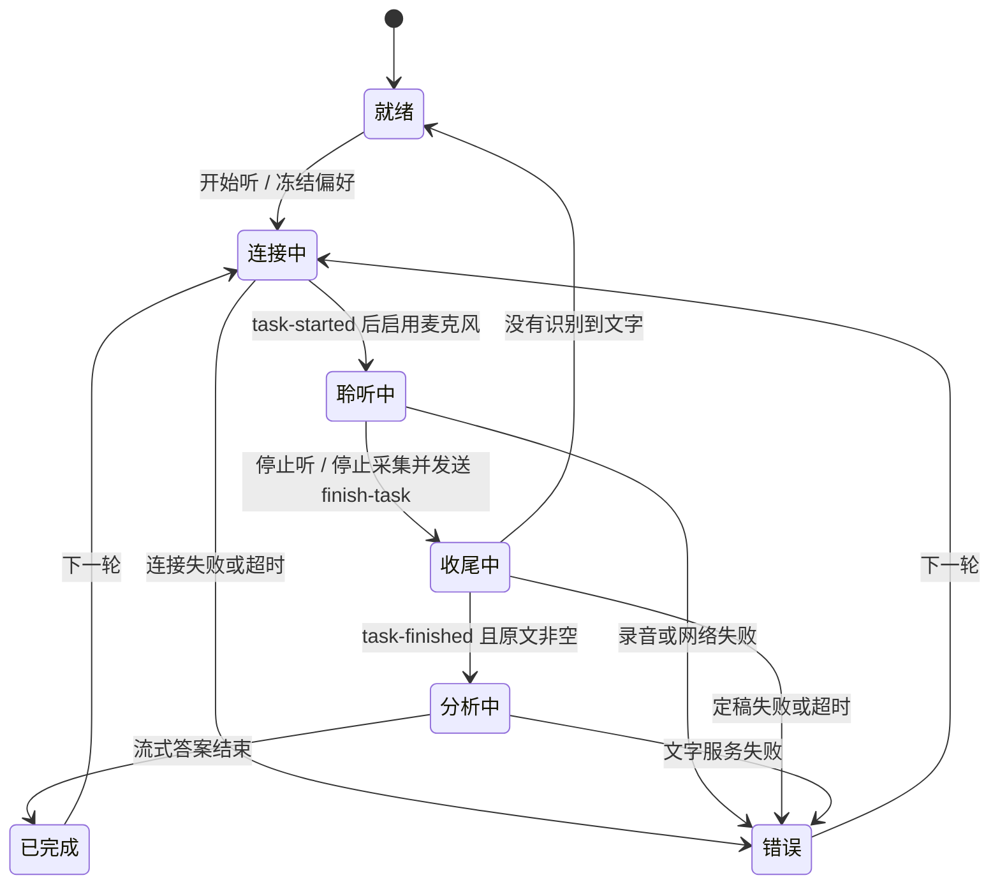

# 产品与交互设计

## 1. 目标与版本范围

把周围讨论转成可读原文，支持停止后分析的单次模式，以及持续听写、自动更新建议的自动模式。优先保证原文完整、响应可见和回答可靠。Android 原生首版，主要面向横置手机，同时支持竖放、折叠屏大内屏和窗口缩放。

本版：Fun-ASR 实时识别 + DeepSeek 文字分析；设置可更换文字服务的 OpenAI 兼容 Base URL / 模型 / 密钥。录音识别与其他实时供应商后续增加独立适配器。暂不接入 Sign in with ChatGPT，不将网页登录或订阅用量视为 API 授权。

## 2. 主界面

主界面包含答案、听写原文、开始 / 停止聆听、常亮开关、设置入口与简短状态。模型设置全部进入独立设置界面。

应用图标保留原有麦克风轮廓，采用标准自适应图标：普通模式为白底黑色麦克风，背景由桌面统一裁切，不在前景中嵌入方形底板。Android 8–12 使用前景 / 背景两层，Android 13 及以上另提供相同轮廓的单色主题图层，由系统按用户主题配色。图层画布 108×108dp，麦克风放在中央安全区域，常规与圆形图标入口共用同一资源。

实现依据：[Android 自适应与主题图标文档](https://developer.android.com/develop/ui/compose/system/icon_design_adaptive)。

### 顶部工具栏

不显示应用名称。三横线按钮右侧的信息区域仅显示偏好名称，18sp、左对齐并垂直居中，点击弹出选择对话框，不加「回答偏好」前缀；未选配置显示「未使用偏好」。长名称单行省略，保留完整无障碍描述。本轮已冻结的偏好与下一轮选择不同时，明确显示「本轮：… · 下轮：…」，避免误以为正在进行的请求已改变。

当前状态移至答案区顶端，替换「答案与提示」固定标题，使用 14sp；它位于答案滚动视图外，工具栏收起、滚动答案时都保持可见。显示准备就绪、连接、聆听、收尾、分析、完成或错误等当前状态；聆听时保留时长，自动分析进度、覆盖时间、错误和可点击的「有更新」沿用同一行并可换行，文字模型分析时仍明确显示正在聆听。答案区背景与页面使用同一主题 surface，正文使用配套 onSurface，取消答案区的色块分隔；听写原文保持独立面板。

工具栏右侧依次为灯泡和「输入来源」图标，输入来源位于最右侧；两者无常驻底板或边框，保留透明按下反馈及 48×48dp 触摸区域。灯泡控制屏幕常亮：开启时为主题主色实心，关闭时为正文色空心轮廓；无障碍名称随开关改变。主界面不再提供三点菜单，设置和新议题统一位于左侧议题抽屉。

点击灯泡后短暂显示「保持屏幕常亮」或「屏幕正常熄灭」；点击 Auto 后显示「自动分段」或「手动分段」。使用与会议删除提示相同的系统 Toast 外观，两种开关使用短时长，不再定位到按钮旁。快速切换取消旧提示，仅保留最近一次状态；对应键盘快捷键同样提示。切换页面、退出前台时取消提示，不在重新显示页面时重复弹出。

复制答案使用双页复制图标，位于答案状态行最右侧；有历史答案时，历史入口位于状态文字与复制按钮之间。复制听写原文使用相同图标，位于听写原文面板标题行右上角。两者仅显示图标，不绘制按钮轮廓、边框或底板；保留不可见的 48dp 触摸区域和按下反馈，分别提供「复制答案」「复制听写原文」无障碍描述。按钮不随上下工具栏收起、不随正文滚动；原文收起时随原文面板隐藏。复制使用当前议题的完整答案 / 完整原文，保留已有未定稿标记；空内容提示暂无内容，不覆盖剪贴板。

顶部工具栏（左侧新增会议按钮）与底部操作区同步显隐。进入主界面或新议题后，约 4 秒无触摸操作就一起收起；语音连接中也遵循闲置收起，真正开始聆听后显示约 1 秒再收起。聆听、收尾、分析和结果阅读期间均保持自动收起。轻点主界面任意位置临时显示上下两区约 4 秒，再次轻点重新计时。按钮照常执行自身功能，不吞掉事件；拖动滚动、多指手势和长按不会唤出。手指按住、选字或菜单 / 新议题确认框打开期间暂停收起。偏好 / 常亮快捷键也会临时显示工具栏；录音快捷键在上下两区隐藏时仍可开始 / 停止，滚动快捷键不会唤出操作区。错误会主动展开约 4 秒后恢复收起，状态行仍显示错误。窗口失去焦点时暂停计时并清理未结束的触摸；焦点返回后重新安排约 4 秒收起，避免系统弹窗吞掉抬手事件后工具栏永久停留。启用触摸探索无障碍服务时不自动收起。

收起采用约 200ms 高度与透明度动画，顶部 56dp 与底部 60dp 均让给内容区，保留原有阅读位置（新滚动范围允许时），不因动画切换双栏模式。底部聆听 / 停止、原文切换以及任务取消 / 重试随操作区一起收起，轻点即可恢复操作。仅隐藏应用控件，系统状态栏与导航栏保持原样。旋转保留显隐模式，不重启录音。

- 竖屏：答案为主体；原文可展开；底部操作区显示时提供大尺寸聆听按钮。
- 横屏且高度较小：优先答案，原文默认收起为可展开入口。
- 宽高都充足：默认左侧原文、右侧答案，分别滚动；仍可通过「收起原文」隐藏原文，让答案占满内容宽度，之后点击「听写原文」恢复。
- 用户主动选择显示 / 隐藏原文后，跨旋转、折叠 / 展开和设置页往返保留选择，不被大屏默认布局覆盖；原文翻页键在原文隐藏时仍自动展开。选择随会议保存，冷启动恢复该会议的选择；未作选择的会议按屏幕尺寸采用默认布局。
- 布局根据可用宽高决定；系统栏、刘海使用窗口边距；中缝 / 特殊折叠姿态需要真机验收，初版不声明完整铰链识别能力。
- 旋转与窗口变化不重启任务，不清空文本或答案；保留两区滚动位置与展开状态。
- 答案使用可选择复制的 Markdown 文本，正文 17sp，代码等宽显示，长行换行以适应手机宽度；原文正文 14sp。两区行距均为基础字体行高的 1.05 倍加 2dp，减少翻页，同时保留系统字体缩放支持。
- 录音后仍保留结果供阅读；同一会议的新一轮保留历史原文与答案，追加当前轮；「新议题」创建独立记录（见第 11 节）。

## 3. 工作流程与状态

只在服务端 `task-started` 后开始采集 / 发送音频，避免音频先于识别任务。显示连接状态，不能让用户误以为连接时已经在录音。ASR 中间结果会修订同一句，不重复追加。停止后等待 `task-finished`，避免漏掉尾句。没有完整定稿时不自动用半成品触发分析。

单次模式每轮只提交一次文字请求。连接时可取消；收尾和分析时聆听按钮禁用，可以取消任务。停止与切换按键有状态保护；空原文不调用文字模型。取消 / 失败保留已收到文本，并明确提示不完整；文字分析失败可手动重试已定稿原文，重试使用当前保存的文字模型与密钥，仍保留本轮回答偏好快照。取消不会自动重试或产生下一次收费请求。任务结束即释放运行时凭据引用；清除密钥后重试必须重新配置，不能复用旧密钥。

麦克风仅在应用前台使用；退到后台或锁屏会终止未完成聆听，提示重新开始，不悄悄持续录音。旋转除外。初版不提供后台录音服务。进程被系统杀死不恢复录音，已记录会话加密保存，恢复后未完成任务标记中断。

## 4. 回答准确性与上下文

输入按层组织：基础规则、用户保存的回答偏好、最近若干轮真实听写、当前定稿原文。听写是待分析的数据，录音中的指令不能覆盖应用规则。历史 AI 答案不作为已证实会议事实。

要求模型先判断当前明确问题，区分「原文提到的事实」「解题 / 分析建议」「假设与待确认信息」。信息不足时指出缺口，给条件式思路。遇到「刚才讨论的问题」只从传入的历史原文寻找，找不到就明确说明。算法回答应列出前提、代码、复杂度与边界；未经运行验证的代码不得声称已测试。金融分析不得编造财务数字。

每场会议的模型上下文限定为最近 6 轮且总计约 12,000 字符；完整记录仍在本机保存，模型预算不限制历史记录数量；当前一轮最多 24,000 字符，超限中止并提示拆分，而非静默截掉当前问题。ASR 错字、远场拾音和多人重叠仍可能影响答案；UI 同时展示原文供核对。模型正确性需要场景样例评估，不能由一次连通测试证明。

## 5. 回答偏好

设置中维护有稳定 ID 的命名配置。可以新增、编辑名称 / 正文、保存并使用、选择、删除和撤销删除。未保存的编辑不改变正在使用的配置，退出编辑时确认放弃。选择「不使用回答偏好」保留通用基础规则。

首次初始化添加两个普通配置，可编辑或删除，删除后重启不重新生成：

| 名称 | 初始正文 |
| --- | --- |
| 算法讨论 | 算法讨论，主要目标是回答题目，语言偏好是 C++。先给思路，再给代码、复杂度和边界条件。 |
| 金融会议 | 金融会议，主要目标是提出质疑，重点围绕负债情况。优先列出需要核实的问题，区分已知事实与信息缺口，不臆测未提及的数据。 |

主界面点击偏好名称弹出单选对话框，包含「不使用回答偏好」及全部已保存配置；选中立即保存并关闭，不进入设置页。对话框打开时暂停工具栏收起，关闭后恢复计时。

单次模式录音开始时保存本轮配置快照（包括正文）。录音、收尾、生成时的偏好切换只影响下一轮；主界面显示本轮与下轮偏好差异，不触发重算。题目中明确语言等约束优先于配置的一般偏好。删除正在选择的配置改为「不使用」；已冻结快照保持可追溯。重命名不改变快捷键绑定。

## 6. 蓝牙 / 外接键盘与快门

按 Android 收到的硬件 KeyEvent 绑定功能。设置页提供显式按键捕获、清除绑定、恢复默认与冲突提示，不做静默覆盖。快捷键可整体关闭，只在主界面前台生效，设置输入、中文输入法和按键捕获不触发会议操作。

| 功能 | 初始键位 | 长按 |
| --- | --- | --- |
| 答案向上 / 向下滚动 | 上箭头 / 下箭头 | 允许重复 |
| 开始 / 停止聆听 | 空格 | 每次按下只触发一次 |
| 切换自动模式 | 未绑定 | 同上 |
| 新建会议 | 未绑定 | 同上 |
| 上一个 / 下一个会议 | 未绑定 | 同上 |
| 显示 / 隐藏听写原文 | 未绑定 | 同上 |
| 不使用偏好 | 0 | 同上 |
| 算法 / 金融初始配置 | 1 / 2 | 同上；新增配置不自动分配 |
| 常亮开关 | L | 同上 |
| 原文向上 / 向下翻页 | Page Up / Page Down | 允许重复，每次约 0.8 页 |

新增四个动作使用普通可保存的自定义按键映射，升级不改动已有绑定。会议上 / 下切换使用侧栏的顺序（最近更新在前），跳过不在历史中显示的待开始草稿，首尾不循环；空历史或到达边界时仅短暂提示，不新建会议。有历史但当前为未列出的草稿时，进入最近的会议。新建 / 切换只负责导航，不自动启动麦克风。聆听中与侧栏操作共用停止确认，取消则继续原聆听；确认后等待尾句，再切换。收尾导航尚未完成时忽略新的导航请求并提示等待，避免重复新建或改变目标。分析中的原会议可继续完成，结果仍归属于原会议。

原文显隐按键与 UI 按钮共用切换逻辑，在顶部 / 底部控件隐藏时仍可用，且不会唤出控件；在大内屏默认显示原文时同样能隐藏，显隐选择与阅读位置随会议保存。四个动作均抑制长按重复；设置页、输入、对话框及快捷键整体关闭时不触发。

原文翻页键会先展开原文。两区独立滚动；用户向上查看原文时暂停跟随，回到底部恢复。按键绑定指向配置 ID，删除配置同时删除绑定；撤销时仅在该键仍空闲时恢复。蓝牙快门可能发送音量、拍照或普通键值，应通过按键捕获实测配置；未绑定的音量键继续交给系统，不默认占用。不承诺后台、息屏或所有遥控器兼容。

## 7. 常亮

默认关闭；用户开启后以窗口 `FLAG_KEEP_SCREEN_ON` 保持前台屏幕点亮，停止听写后继续用于阅读。退出前台后系统恢复正常策略，不修改系统屏幕超时、不阻止手动锁屏。开关状态跨旋转保留，冷启动默认关闭。

## 8. 设置与安全

设置正文的模型连接、音频输入、图像输入、上下文预算、聆听模式、回答偏好、外接按键和数据隐私均为可折叠分区；模型连接内的图像识别服务也可独立折叠。首次默认收起，点击整行标题或箭头展开；展开状态在本机保存，离开设置、旋转或重新启动后恢复。页面顶端的设置标题及返回按钮保持固定。折叠只隐藏原有视图，不丢弃尚未保存的模型输入，也不绕过保存和离开时的未保存确认。标题提供中英文展开/折叠说明及原生无障碍操作。

页面、左右侧栏和音视频输入设置统一使用当前主题 surface，与手势导航区衔接；按钮、选中项和原文面板继续保留各自的圆角与层次。音频电平条未填充部分与背景同色，有音量时以主题主色显示，不绘制独立底板。

语音：Fun-ASR WebSocket 地址、模型、密钥。文字：OpenAI 兼容 Base URL、模型、密钥。启用 TLS，禁止带用户名密码 / 查询串的地址；禁止 HTTP 降级与跨域重定向携带凭据。模型设置在任务期间不可修改。

密钥 Android Keystore AES-GCM 加密后存入私有配置，显示为密码输入；备份关闭。音频不落盘、无默认日志记录请求体或识别结果、无统计埋点。保存的偏好和非敏感设置保存在本机；提供清除密钥入口。发布前按安全文档扫描项目。

## 9. 后续扩展

录音文件 ASR 使用异步任务 / 文件上传边界；新增提供商实现相应能力，不能用 OpenAI 兼容文字接口假设音频协议通用。未来可增加导出、更多供应商、OAuth、更多自动分析策略。所有扩展应保持「用户能判断是否正在录音 / 发送 / 思考」的状态可见性。

## 10. 自动模式

底部顺序为 Auto、开始听 / 停止听、听写原文。Auto 开启时采用 tertiaryContainer / onTertiaryContainer 并显示勾标记，关闭时恢复普通主题容器背景，并提供开关状态无障碍描述。设置页保留「自动模式」开关，两处同步且持久保存；切换只选择策略，不自动开启麦克风。快捷键新增「切换自动模式」，默认不绑定，长按不重复触发；按钮随底部操作区收起，隐藏时按键仍有效。

开始听后持续使用同一个麦克风和同一个实时 ASR 连接。中间听写只展示，定稿段落用于分析。约 1.2 秒没有新的语音变化时合并稳定段落；明确问题 / 纠正优先调度，连续讲话约 8 秒检查一次新增定稿。实时自动请求的启动至少间隔 5 秒；停止后的尾段分析和手动重试不受此等待限制。纯语气词不单独触发。以上为可调启发式，并非语义完整或端到端延迟保证。

语音状态和分析状态独立：正在生成答案仍显示正在聆听，停止键一直可用。最多一个文字请求在途，期间新原文继续完整写入，待分析内容合并为最新快照，不逐句堆积请求。文字错误 / 超时保留已有答案、允许手动重试，不中断录音，也不自动重试同一输入。ASR 中断则明确报错、释放麦克风，不把断流伪装成持续聆听。

分析输入包括此前轮次的真实原文、当前问题及补充的定稿；模型按时间顺序判断问题、约束、未知项与纠正，先前 AI 答案不当作会议事实。每次请求冻结所选偏好，切换后下一次更新使用新偏好，旧偏好的迟到结果不得覆盖。普通补充到来时允许先显示有覆盖时间的旧快照答案，再更新，避免持续讲话导致永远无结果；已提交段落修订或明确纠正 / 换题时抑制旧请求结果，等待最新快照。

首个答案可流式显示，后续版本完整生成后替换同一答案。用户向上阅读或选字期间暂存新版，在常驻状态行提示「有更新」，点击标题或回到底部应用；更新不强制滚动。状态行同时显示「更新中」、已覆盖的定稿时间及文字错误，工具栏隐藏时也能判断分析进度。

停止听立即停止采集，排空尾帧后发送 finish；ASR 收尾期间不再启动新文字请求。收尾后保留当前在途请求，最多为未覆盖尾段追加一次最终分析，没有新信息就不重复调用。关闭 Auto 时不再安排后续自动请求，已发起请求可完成；ASR 不重启，停止后按单次流程分析。聆听中开启 Auto 会分析已有稳定原文。切换到单次模式时冻结当时所选偏好。

自动模式完整显示本轮原文，模型输入最多保留 24,000 字符（开头问题约 6,000 + 最近约 18,000，中间省略明确标注），不会因此删除显示原文；超长讨论可能丢失中间约束，需结合原文核对。历史仍为最近 6 轮 / 12,000 字符；记忆超长轮次采用相同显式摘取。整轮未启用过 Auto 时保持原有超限错误规则；曾开启 Auto 的轮次即使中途关闭，也继续保留完整原文并使用显式首尾截取。单轮仍有 15 分钟保护，自动停止后走尾段分析，不承诺无限时会议。

电脑验收须模拟文字模型阻塞 30–60 秒，期间不断送入音频和多个定稿段，验证原文、音频帧无缺失且麦克风只启动一次；同时覆盖停止响应、Auto 切换、偏好切换、纠正、迟到回调、尾段只补一次、文字错误隔离、阅读时暂存更新，以及横竖屏 / 大内屏按钮可达性。真实蓝牙传输与长时间远场拾音留给真机验收。

## 11. 议题集与议题管理

当前行为以 [TOPIC_COLLECTIONS.md](TOPIC_COLLECTIONS.md) 为准。原「会议」重命名为「议题」，上层增加单级「议题集」。议题各自保存原文、OCR、答案、历史、偏好、上下文与阅读位置；同集议题也不共享模型上下文。

左上角三横线打开覆盖式侧栏（最大 360dp，窄屏最大可用宽度 86%）。顶部只有一个「＋ 新建议题」和新建议题集图标；内部不再重复新建入口。新建跟随选中的议题集或议题所属集，无选择时进入默认集。文件夹箭头仅折叠/展开；点名称选中该集准备页；点议题恢复该议题。只有选中的议题集/议题显示各自融入行背景的无底板三点。底部固定设置，保持原有遮罩/返回关闭及快捷键隔离。

议题集按修改时间分今天、昨天、近 7 天（2–6 个日历日前）、更早月份，组内新到旧；默认集在末尾、不参与日期分组。侧栏打开时冻结排列，生成只更新状态，关闭重开再排序。默认集可重命名/清空，不可删除；旧记录全部原样归入默认。其他集支持新建、重命名、删除、移动全部议题后删除；议题可重命名、移动、删除。移动保持原 ID 与分析归属。

新议题与切换仍沿用停止确认、排空尾帧、等待定稿；文字/OCR迟到结果留在原议题。删除当前议题优先选择同集其他议题，最后一个删除后留隐藏准备草稿。删除所选议题集回到默认。删除会取消所属任务，写盘失败保留数据，迟到回调不复活记录；不保存音频，不自动重录或付费重试。

原快捷键绑定 ID 保持兼容，上一/下一议题只在当前集内移动；新增上一/下一议题集，默认不绑定，切到目标集恢复上次议题或准备页。两类首尾不循环。设置/API Key仍全局共享，目录不增加模型或偏好继承规则。

## 12. 界面语言

跟随系统首选语言：简体中文显示中文，其他语言统一显示英文，包括繁体中文。中文使用显式 Hans 脚本，或未指定脚本且非台湾 / 香港 / 澳门地区时的简体默认；Hant 优先判定为繁体。读取系统语言顺序，不因系统次选语言中包含简体中文而覆盖非中文首选。英文回退使用从左到右的界面。

主界面、侧栏、设置、确认弹窗、无障碍说明、Toast、会话状态、错误、默认议题名称和原文轮次 / 未定稿标记均提供双语资源。系统切换语言后重建页面，保留当前议题、任务和阅读状态，不自动开始聆听。已有原文、答案、自定义名称和偏好配置按原数据显示；首次安装的预设偏好按当时界面语言初始化，之后不因语言切换覆写或重新添加已删除配置。默认模型规则使用当前问题所用语言回答，明确指定语言时遵从用户要求。

本版不增加应用内语言选择器；详见 [本地化维护说明](LOCALIZATION.md)。

## 13. 图像输入与 OCR（首版已实现，待真机验收）

完整方案见 [图像输入与 OCR 设计](OCR_INPUT.md)。主界面新增覆盖式右侧图像栏，可快速开关视频输入、选择实际可用来源，并直达独立图像输入设置页；左右侧栏互斥，不常驻占用阅读空间。顶部右侧增加图像栏入口，与灯泡及现有控件一起收起，不恢复主界面三点菜单。

视频开启时底部提供手动抓拍图标，关闭时彻底隐藏且不留占位；抓拍可绑定蓝牙按键，未聆听也能识别并生成答案。关闭视频不停止麦克风，已接受的图像继续识别。主界面不显示预览，只在实际抓取成功后短暂提示；预览和裁剪位于图像输入设置，识别服务配置位于主设置的模型连接。

图像结果保留文字位置、布局及 UI 角色，作为独立资料结合听写和偏好交给文字模型；语音采集、图像识别与分析独立运行。本节扩展现有语音轮次、状态及记录规则，具体实现和能力边界见专项文档第 12 节；相机、USB 硬件和实体抓拍按键待真机验收。

## 输入控件与模型连接（2026-10-28）

左右侧栏及输入设置共用 `UiControls`：胶囊动作按钮、暗色圆角单选行、滑动开关、透明图标按钮。音视频来源都使用原生 RadioGroup / RadioButton 语义，选中项以品牌色圆环和浅色背景突出；整行可点，至少 48dp 交互范围。视频启停使用 Switch；状态行右侧分别放置刷新图标，提供中英文无障碍名称。右侧栏整体滚动，输入设置页也可滚动，短横屏不会裁掉来源或入口。返回图标不绘制常驻背景。

图像输入设置仅管理来源、启停、预览、裁剪；图像服务 HTTPS Base URL、模型、密钥和 Qwen 坐标格式移动到主设置的模型连接区域，位于统一保存按钮之前。三个服务的设置和新密钥使用一个 SharedPreferences 提交；密钥仍分别通过 Keystore 加密，空白保持现有值，旧配置无需迁移。未保存提示、非法配置校验、任务进行中保护继续生效。保存失败恢复内存中的原配置；刷新或选择来源不会隐式开启录音/摄像头。聆听中切换音频仍先确认，取消后单选行保持原选项。

## System theme

See [THEMING.md](THEMING.md) for automatic system light/dark mode, dynamic color roles, fallback palettes, state preservation and validation.
