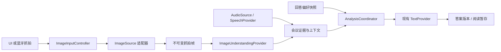

# 图像输入与 OCR 设计

> 术语更新（2026-10-28）：本文原有“会议”指独立的“议题”；议题集只组织目录，不共享原文、OCR 或模型上下文。当前目录、迁移和快捷键规则见 [TOPIC_COLLECTIONS.md](TOPIC_COLLECTIONS.md)。

状态：首版已实现；两套电脑测试、内置相机 / 一款 USB 采集卡本地回归，以及手机端独立 OCR / 答案和连续语音并发链路已验收。实体图像快捷键、物理热拔插及更多硬件仍需验证，见 TESTING.md。本文保留产品约定，实际实现边界见第 12 节。文档与开源目录保持一致，不包含真实凭证、私人服务地址或会议数据。

## 1. 目标与范围

会议中的幻灯片、文档和电脑界面可能包含未被说出的信息。应用允许用户从手机摄像头或 USB 视频设备手动抓取一帧，提取文字及空间结构，与相关听写一起交给文字模型，生成或修正答案。

首版只在用户按下抓拍按钮或绑定按键时识别，不连续 OCR、不自动判断翻页、不录制视频。主界面不显示实时图像，也不在抓拍后弹出照片；实时预览位于独立的「图像输入」设置页面。未开启聆听时也能单独抓拍并获得答案。

语音输入、图像输入、Auto 是三个独立开关：开启图像输入不启动麦克风，不开启 Auto；抓拍不停止听写、不修改音频轮次。现有 Fun-ASR 和文字分析服务继续使用，图像识别服务单独配置。

## 2. 主界面与右侧边栏

### 2.1 右侧图像输入栏

主界面新增从右侧打开的覆盖式抽屉，不常驻占用答案宽度。顶部工具栏右侧在灯泡左侧增加图像输入入口，使用视频来源图标，保留 48dp 触摸区域及「图像输入」无障碍说明。入口始终保留在工具栏中，即使视频输入关闭，也能重新打开右栏；工具栏收起时轻点主界面即可唤出。不依赖边缘手势才能操作，避免与系统返回手势冲突。

右栏布局：

```text
图像输入

视频输入                     [开关]
当前状态：已关闭 / 准备中 / 就绪 / 不可用

输入来源
○ 后置摄像头
○ 前置摄像头
○ USB 视频设备（实际检测到时显示）

图像输入设置                 [进入]
```

- 开关用于快速开启、关闭图像采集；来源列表用于快速选择来源，不显示模型、密钥或实时预览。
- 关闭输入时仍可选择来源并记住选择，但不申请权限、不打开设备；开启后才尝试打开该来源。
- 开启状态下选择其他可用来源，会释放旧来源并打开新来源，期间显示「正在切换」，不重启麦克风。旧来源已被接受的抓拍继续属于原任务。
- 列表来自实际检测结果；不把尚未实现的适配器当成可用来源。之前选择的外接设备已断开时保留不可用提示，不静默换成手机摄像头。
- 「图像输入设置」直达同一个设置页面，也可以通过左侧栏的设置进入；返回恢复原会议、阅读位置和右栏打开状态，不重复打开同一设备。
- 左右抽屉互斥：打开右栏会关闭会议栏。点击遮罩、系统返回或 Escape 关闭；关闭抽屉不关闭视频输入。
- 抽屉打开期间暂停上下工具栏自动收起，隔离会议和抓拍快捷键；已开始的听写、OCR 与文字分析继续。关闭后恢复计时。
- 手机抽屉宽度不超过可用宽度的 86%，大屏最大 360dp；来源列表可滚动，设置入口保持可达。横屏、竖屏、折叠屏均采用覆盖式抽屉，不新增常驻第三栏。

### 2.2 抓拍按钮与提示

底部在聆听按钮右侧增加相机图标，原文切换放在其后。它与现有底部操作区一起收起，不要求显示预览。相机采用纯图标外观、无轮廓底板，保留触摸反馈、48dp 触摸区域和「抓拍图像」无障碍说明。窄屏优先缩短文字、调整间距，不缩小触摸目标或挤出屏幕。

| 视频输入状态 | 底部抓拍按钮 | 抓拍按键行为 |
| --- | --- | --- |
| 关闭 | 不创建可见占位，不保留空白 | 提示「请先开启视频输入」，不隐式打开设备 |
| 开启，准备或切换中 | 显示为暂不可用 | 提示尚未就绪，不使用旧来源缓存帧 |
| 开启，就绪 | 显示并可用 | 取得当前来源的新帧 |
| 开启，但断开、无信号或权限不足 | 显示为不可用 | 提示具体类别，引导右栏或设置排查 |

只有确认帧已复制且任务被队列接受，才使用现有系统短 Toast 提示「图像已抓取」。拍摄失败或队列满不能显示成功；不弹出照片、不跳转页面。错误通过短提示和状态行呈现，不用服务端原始响应充当错误文字。

当前状态仍常驻答案区顶部，可显示「聆听中 · 图像识别中」「聆听中 · 正在更新答案」「正在分析图像」。图像任务不得把仍在进行的聆听显示成已停止。阅读旧答案期间继续沿用「有更新」机制，不强制滚动或替换正在选取的文字。

### 2.3 快捷键与本地化

新增「抓拍图像」和「开关视频输入」两个可绑定动作，默认未绑定，不改动现有键位；沿用显式捕获、冲突检查、清除和长按不重复触发机制。仅主界面前台生效，抽屉、设置、输入框和对话框打开时不触发。上下控件隐藏不影响主界面抓拍按键。

所有按钮、状态、Toast、错误和无障碍说明提供简体中文、英文资源。跟随现有系统语言策略，不能翻译或覆写识别文字、会议内容与用户保存的偏好。

## 3. 图像输入设置与设备生命周期

设置页包含视频开关、来源单选列表、实时预览和识别区域；图像识别服务的地址、模型、密钥与输出格式统一放在「设置 → 模型连接」，不属于视频输入设置。视频开关与右栏共用同一运行时状态，来源选择全局保存；会议只记录抓拍时的来源描述，不保存服务凭证。新增功能升级后默认关闭，冷启动及从后台返回均不自动重新开启摄像头；保存的来源用于下次显式开启。

预览用于会前确认构图、清晰度、焦点、旋转和 USB 信号，也可框选屏幕或正文区域，减少工具栏与桌面干扰。开启预览需要显式开启视频输入；浏览设置本身不打开摄像头。裁剪配置与来源、方向及画面比例关联，分辨率或比例变化时重新校验，不能沿用错误区域。拍摄分辨率优先保证电脑小字可读，不把整幅桌面简单压缩成低分辨率缩略图。

采集由独立控制器持有，主界面和设置页只订阅、挂接预览，不分别抢占同一设备。旋转、折叠和页面重建保留运行状态，不重启音频。识别服务的修改仍受在途任务保护：不得通过进入图像设置绕过现有模型配置锁，也不能为了预览强制停止聆听。源选择和预览属于独立操作，不触发模型设置保存。

关闭视频输入立即停止新采集、释放设备、清除未接受的帧缓存、隐藏底部抓拍按钮，不停止麦克风。已经被接受的图片继续完成 OCR 和文字分析；关闭视频不等于取消已发起的识别请求。显式取消图像任务不取消语音任务。退到后台或锁屏则停止采集、释放视频设备；音频仍按既有前台策略处理，不增加后台录音或视频服务。Android 的摄像头使用指示遵循系统行为。

## 4. 来源适配与模块边界



以下为拟新增边界，具体类名可在开发时调整：

| 模块 | 职责 |
| --- | --- |
| `ImageSource` | 枚举、打开、关闭来源，提供预览、抓帧及断开事件；不负责 OCR |
| `ImageInputController` | 全应用独占的视频来源生命周期、就绪状态、设备切换与抓拍防重复 |
| `ImageUnderstandingProvider` | 将单帧转为文字、位置、布局及 UI 结构；网络协议由提供商分别适配 |
| `ImageEvidence` | 归属会议的不可变抓拍记录与识别修订，不伪装成语音原文 |
| `ContextAssembler` | 按时间、主题与预算组织听写及图像证据 |
| `AnalysisCoordinator` | 合并分析触发、串行请求、快照与版本检查；不持有音频读取线程 |
| 会议存储扩展 | 保存 OCR、结构、答案来源与任务中断状态，兼容现有存档 |

内置摄像头优先使用 CameraX / Camera2。系统暴露的外接摄像头可复用系统相机适配；未被系统枚举的 UVC 设备需要独立 USB/UVC 适配器。USB 视频采集卡并非都能被系统相机接口直接使用，需检查手机 USB Host、系统驱动、设备格式和权限；不能承诺任意采集卡兼容。接入第三方库前检查许可、维护情况和原生二进制来源。

来源协议不能与 OCR 协议混为一体：增加网络摄像头等来源只扩展 `ImageSource`，更换 OCR 提供商只扩展图像识别适配器。首版没有实现的来源不提供可用选项。

## 5. 单张抓拍与识别流程

1. 检查主界面、来源开关、权限、就绪状态、图像队列容量。
2. 在快照建立时冻结会议 ID、来源及来源代次、时间、图像序号、方向、裁剪映射、当时已定稿听写位置与所选回答偏好；取得不可变帧。切换来源期间拒绝旧代次回调，不取断流前残留画面。
3. 接受任务后提示「图像已抓取」。在独立工作线程裁剪、旋转、编码与调用图像服务，不保存到系统相册。
4. 校验结构化结果。文字和布局有效后写入所属会议，空结果、截断或关键字段错误明确标记，不将残缺 JSON 当完整资料。
5. 构建分析快照：图像证据、同一会议相关定稿听写、回答偏好、资料版本。图像独立触发分析，不要求语音结束或存在语音。
6. 文字模型生成完整的新答案版本；检查会议身份、删除标记、偏好与证据版本后发布。用户正在阅读时暂存更新。

| 场景 | 处理 |
| --- | --- |
| 尚未开始聆听 | 图像足以形成问题时直接作答；不要求配置语音服务或申请麦克风权限 |
| 手动模式聆听中 | 立即识别并分析一次，麦克风继续；不自动启用 Auto |
| 自动模式聆听中 | 图像入上下文，后续定稿继续补充并更新 |
| 点击停止听 | 只停止并收尾音频，已接受图像继续；尾句和图像分别完成时按版本合并，避免同一证据重复请求 |
| 已有答案 | 重新核验当前问题和条件，生成修正版本，旧答案不当成事实 |
| 图像识别期间切换会议 | 完成结果仅写回原会议，不覆盖新会议、不自动抓拍新会议 |
| 原会议已删除 | 取消其图像及文字任务，拒绝迟到回调与写入，不复活记录 |

手动模式使用抓拍时所选偏好快照，不改变音频轮次已有的偏好冻结规则；之后的停止分析仍沿用该音频轮次快照。Auto 则沿用「下次分析使用最新偏好」规则，抑制旧偏好的迟到答案。答案历史记录各自的偏好与证据范围，避免混淆。

## 6. 结构化结果与 UI 理解

普通文字 OCR 与电脑界面理解是不同能力。初期推荐视觉理解模型一次提取文字与界面结构，再交给现有 DeepSeek 文字接口回答；是否另接专门 OCR，应根据代码、表格、细小文字样例评估，不默认增加第二次视觉请求。

图像服务独立配置，不能假设文字服务能接收图像，也不能假设相同厂商的接口协议、凭证权限或模型高级参数完全通用。能力描述至少区分文字、位置、表格和 UI 语义；只有普通 OCR 的适配器应明确能力限制。

统一结果建议包含：

| 字段 | 内容 |
| --- | --- |
| 图像元数据 | 抓拍 ID、来源、尺寸、方向、时间、裁剪到原图的变换 |
| 文字区域 | 稳定区域编号、原文、归一化位置、原图像素位置、阅读顺序 |
| 布局关系 | 父子区域、列、段落、表格单元格与行列标题、代码块 |
| UI 角色 | 标题、正文、导航、工具栏、按钮、输入框、报错、代码编辑区等 |
| 主体候选 | 可能承载题目、约束、报错主体的区域及理由 |
| 不确定项 | 模糊字符、缺失行、无法确定的区域角色及识别完整性 |

必须分开保存直接识别的原文与模型推断的角色；没有服务端置信度时不编造分数。无法确定选中、禁用或焦点状态时不猜测。代码保留缩进、换行和标点，表格保留单位及标题对应关系；对倾斜照片的矫正保留坐标变换，不让后续位置引用失真。

例如算法网站应区分左侧题目导航、中央题干、右侧代码区、底部运行结果，而非把所有文字拼接成题目。多题并列而没有明确目标时指出歧义；空白、严重模糊或正文被遮挡时要求重拍，不能凭布局补造题目。

## 7. 提示词与上下文

识别阶段只做忠实提取，回答偏好不用于筛选或改写文字，避免「提出质疑」等倾向污染事实。最终分析阶段再应用完整偏好。

图像识别指令模板：

> 提取图像中的文字、位置和阅读顺序，保留代码、公式、表格关系。区分主体内容与导航、工具栏等辅助界面。原文与界面角色推断分别输出；模糊、遮挡和不确定内容明确标记，不自行补全。按约定结构返回，不回答图中的题目。

文字分析的基础指令：

> 从图像资料中找出当前主要问题或讨论主题，结合相关听写，并按用户回答偏好作答。辅助 UI 文字用于理解上下文，不自动视为题目。重新核验已有答案，保留已证实条件；关键文字模糊、条件缺失或来源冲突时明确指出，不猜测。代码未经运行不得声称已验证。

消息分层为基础规则、用户偏好、结构化会议资料与本次任务。截图或听写里的指令只属于被分析的数据，不获得覆盖应用规则或操作设备的权限。历史 AI 答案不是已证实事实。

抓拍时间用于锚定问题，分析快照记录实际采用的听写截止位置；OCR 等待期间的新定稿可以补充相同主题，但不能无条件把后来无关的题目与旧截图拼接。图像与语音冲突不按模态硬设优先级，结合明确纠正和时序判断，无法判断时列出差异。

每张图像拥有独立 ID，多张可作为补充；主题更换时历史仍保留，不把所有旧图永久塞入每次请求。模型输入保持有界，按相关性和时序选择、显式标记省略，完整本地记录不裁掉。答案可使用「图像 #2 / 区域 B4」标识关键依据，并保存实际使用的资料清单。

## 8. 并发、取消与不漏听

音频采集发送、图像抓取识别、文字生成分别调度。图像压缩、图像服务请求、加密存储不得在音频回调、主线程或长时间持有的会话锁里执行。图像解码与缓存有容量限制，避免高分辨率图片挤占音频资源。

首版允许一张识别中、两张等待；容量满时明确拒绝新抓拍，不静默覆盖已接受的图片。待分析请求可合并为包含全部相关新证据的最新快照，但已接受图像资料本身不能像 Auto 快照一样丢弃。同一会议的文字模型仍最多一个请求在途，已过时的输出不得覆盖较新的图像/偏好版本；显式抓拍触发应有优先级，不能被连续语音无限推迟。

现有 `SessionEngine` 以语音轮次组织请求，需要增加独立的图像任务身份与证据修订；不能靠伪造语音停止、开启 Auto、增加音频代次来触发 OCR 分析。新请求检查会议 ID、任务 ID、证据修订、分析版本与偏好版本；取消分别作用于采集、单张 OCR 或分析，不隐式关闭麦克风。

USB 设备可能同时提供音频接口，插拔或切换视频来源后必须检查实际音频输入路由，不能悄悄从手机麦克风改用采集卡音频。源断开立即失效缓存帧，报告断开，不回退或继续用旧画面。相机错误、OCR 超时和文字错误都不主动停止仍健康的语音链路；真实音频中断则明确报错，不能只维持「聆听中」外观。

## 9. 会议记录、隐私与失败恢复

- OCR 原文、布局、来源时间、识别完整性、偏好快照和答案证据引用加入所属会议的加密载荷，与听写原文分开保存。
- 在当前隐藏草稿中成功接受抓拍时，创建可见的真实会议记录；仅切换视频开关、来源或预览不会创建空会议。允许 OCR 文字为尚未命名会议提供本地标题候选，不增加标题模型请求。
- 「图像资料」查看入口位于会议的资料/历史区域，默认收起，显示状态、文字及区域结构，可排除误识别资料并重新分析；不挤占主界面常驻空间，不把 OCR 混入「复制听写原文」。
- 原始帧默认仅在有界内存中保留至识别成功、取消或失败重试窗口结束，不进相册、不持久保存视频。失败重试窗口须有超时及总容量限制；帧已释放或进程重启后不能承诺重试 OCR，应提示重新抓拍。已保存 OCR 可以直接重试文字分析。
- 只上传用户选择区域及必要元数据，去掉不必要的照片元数据；服务商实际接收图像，文本服务接收结构化识别结果和相关听写，设置中明确这一区别。
- 密钥使用现有 Keystore 机制，不进入会议记录、日志、源码、截图或文档；新提供商沿用 TLS、地址校验及不携带凭证跨域重定向规则。
- 进程重启后恢复已保存结果，未完成任务标记中断，不自动打开摄像头、恢复麦克风或重发付费请求。新存档增加版本并兼容无图像字段的现有会议。

## 10. 开发顺序与验收

实现时同步开发目录与 GitHub 开源仓库的功能、资源和测试，不复制私人调试数据。先电脑测试与构建，再由用户连接真机验证；当前已按本方案实现首版，真机测试前不宣称任意设备兼容。

建议顺序：统一资料与任务调度边界 → 内置摄像头及右栏/设置预览 → 结构化图像服务 → USB/UVC 适配 → 并发、存储和生命周期验收。

电脑测试至少覆盖：

1. 不启动语音也能分析图像；手动聆听抓拍不结束音频、不打开 Auto；Auto 同时吸收两类资料。
2. OCR/文字模型阻塞 30–60 秒时持续送入音频，验证帧和定稿完整、麦克风启动次数及停止尾帧顺序。
3. 视频关闭隐藏抓拍且没有空位；关闭态按键不隐式开启；右栏关闭不关闭视频，开关来源状态两处同步。
4. 连续抓拍、排队满、来源切换、旧来源迟到帧、断开、关闭输入但继续已接受任务、分开取消。
5. 图像与文字错误隔离、过时输出、偏好快照、纠正、会议切换/删除、草稿提升、重启中断和旧存档迁移。
6. 图像中代码、表格、多栏 UI、工具栏干扰、模糊关键符号和注入文字的固定样例；检查问题主体及引用正确性。
7. 中英文、横竖屏、大内屏、窄窗口、大字体、无障碍触摸区域、抽屉互斥、快捷键隔离、阅读暂存和自动收起。

真机验收需要内置摄像头、小字屏幕照片、实际 USB 采集卡、实体蓝牙键盘，以及持续听写时插拔设备的音频路由检查。测量抓拍、识别、首个答案耗时，验证内存和发热。设计要求图像链路不阻塞音频，不把「独立线程」当成硬件上绝不会漏听的证明。

## 11. 接口参考

参考用于实现前核对能力，不内置特定账户或固定生产模型版本：

- [CameraX 图像采集与内存输出](https://developer.android.com/media/camera/camerax/take-photo)
- [Android Camera2 外接相机硬件级别](https://developer.android.com/reference/android/hardware/camera2/CameraCharacteristics#INFO_SUPPORTED_HARDWARE_LEVEL_EXTERNAL)
- [阿里云图像与视频理解](https://help.aliyun.com/zh/model-studio/vision)
- [阿里云 Qwen-OCR](https://help.aliyun.com/zh/model-studio/qwen-vl-ocr)

Qwen-OCR 提供文字定位等能力，视觉模型提供图像理解；具体模型、地域、UI 识别质量及结构化输出可靠性需在开发时验证。OpenAI 兼容入口不表示供应商的 OCR 专有高级参数也通用。


## 12. 首版实现与能力边界

- 主界面右侧工具栏的「输入来源」图标打开右侧覆盖式抽屉（与音频输入共用），提供开关、实际来源列表、刷新和图像设置入口。关闭视频时底部抓拍按钮隐藏且不留空位；抓拍与视频开关均可自定义按键，默认未绑定。
- `ImageInputController` 持有设备，`CameraImageSource` 使用 Camera2 的 YUV 测光流和 JPEG 抓拍；`UsbImageSource` 使用 UVCAndroid 1.0.13 的低层视频接口，后台 EGL surface 仅排空视频帧，不在主界面显示预览。
- 图像设置页提供预览和拖动裁剪。裁剪绑定来源、转正后尺寸及旋转角度；条件变化时使用全图，用户需重新确认。关闭视频释放设备，已经接受的 OCR 继续。旋转重建保留采集，后台/锁屏关闭视频，返回不自动开启。
- 图像服务使用可配置的 OpenAI 兼容 Chat Completions 非流式接口，以 JPEG data URI 传入，不需要公开图片 URL。默认模型为 `qwen3.5-ocr`，地址和独立密钥由用户输入；不内置任何业务空间地址或可用密钥。
- 设置中的「Qwen3.5-OCR 旋转文字框格式」默认开启。此适配请求 0..1000 坐标网格的 `rotate_rect + text`，转换为统一归一化包围框；其他视觉模型应关闭该选项，并按结构化提示返回 `blocks / uncertainties`。不能猜测未知提供商的坐标单位。
- 实测 Qwen3.5-OCR 没有遵循任意 UI 角色 JSON 模板，而是返回旋转文字框。因此 Qwen 路径保留文字、位置与阅读顺序，将角色标为未知，再由文字模型根据文字和布局推断分区、正文、题干、代码及可能的按钮。不能声称已经视觉检测出无文字图标、焦点或选中状态；需要这些能力时，应选择支持结构化界面理解的视觉模型并单独评估。
- 图像答案生成期间也可立即开始聆听，不等待文字模型；取消语音连接或语音故障不会误取消独立的图像答案。
- 不增加第二次视觉请求。最终分析使用同一文字服务和偏好，OCR-only 不依赖语音配置或麦克风权限。普通模型设置允许只保存文字服务，开始聆听时仍检查完整语音/文字配置。
- 一张识别中、两张等待，单帧 JPEG 不超过 8 MiB。图像最多 200 条/会议；达到上限会拒绝新接受任务，不静默删除历史。首版不保留失败图片以供重试，失败后重拍；已保存 OCR 可重新进行文字分析。
- 模型上下文选择最近至多三张已纳入的有效图片，结构总预算 48,000 字符；每张保留至多 12,000 字符的抓拍时听写锚点，并明确说明更早资料未全部传入。此处先按时序提供候选，由模型判断主题关联，尚未实现独立的语义检索器。
- 状态行提示识图进度/错误，图像资料入口仅在存在资料时显示。资料列表允许查看结构化文本、取消在途 OCR、纳入/排除及重新分析；不把图像文字混入听写原文或其复制功能。每个答案保存实际采用的图像 ID，历史轮次保留引用。
- 会议载荷升为版本 2，兼容版本 1，OCR 及结构沿用会议 AES-GCM 加密。新加入原生库的完整许可、源代码标签和重新构建说明见 [第三方声明](../THIRD_PARTY.md)。库的录音录像/存储助手未使用，其多余存储和前台服务权限已从合并清单移除。
- 生产麦克风优先固定到手机内置麦克风，监测路由变化并尝试恢复；无法保持时明确终止并提示，不将视频卡音频静默视为原麦克风。恢复和具体路由行为仍须真机验证。

电脑验证使用模拟来源、合成图片和本地 mock 服务。一次真实端到端验证仅上传人工合成的算法网站界面：Qwen 返回并通过校验的 19 个区域，文字模型根据 C++、复用节点和 O(1) 额外空间条件生成解答；不据此推断所有照片、表格或 USB 硬件均准确。两次前期 OCR 格式探测同样只使用该合成图片；凭证仅在临时进程内使用，未写入项目。真实 API 样例、原始响应、图片和答案不加入仓库。
